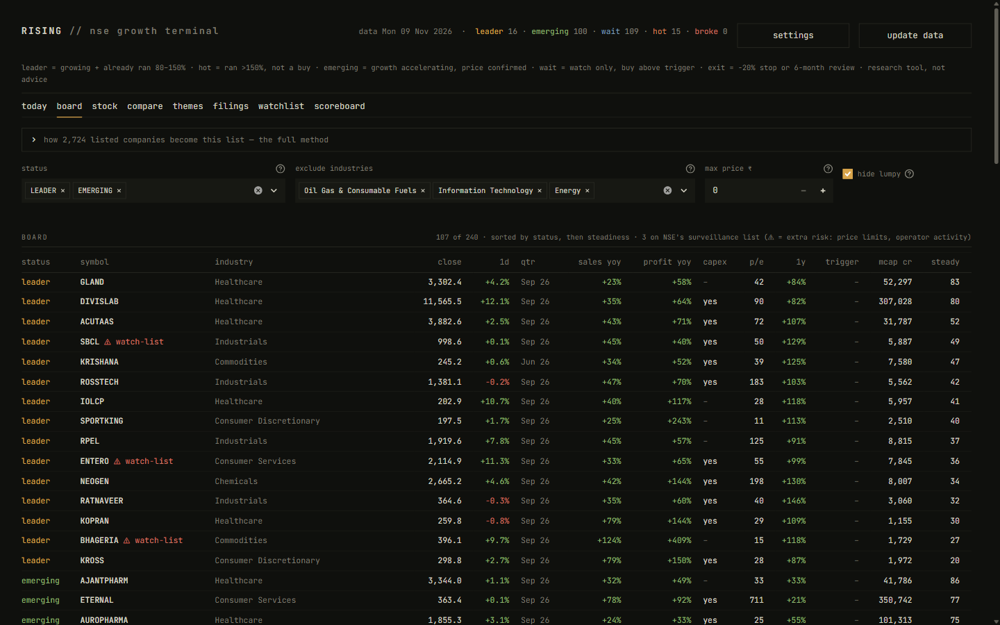
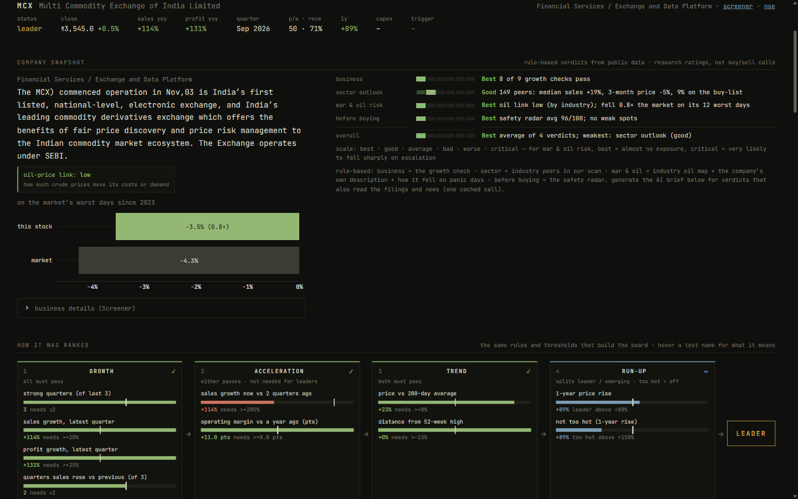
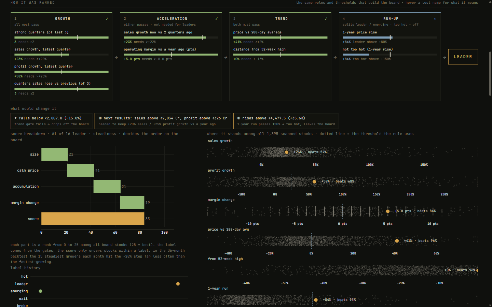
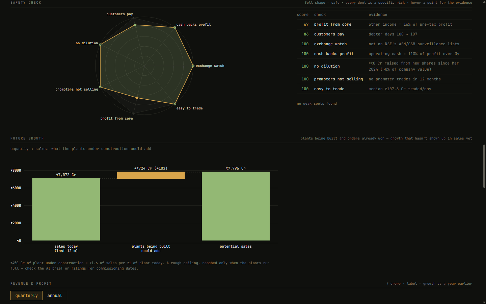
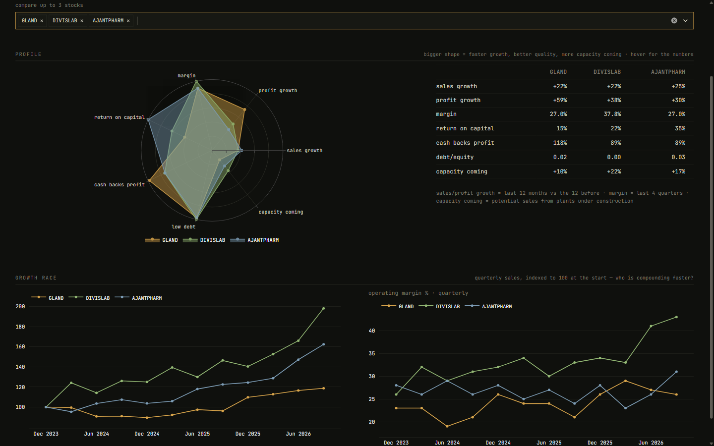
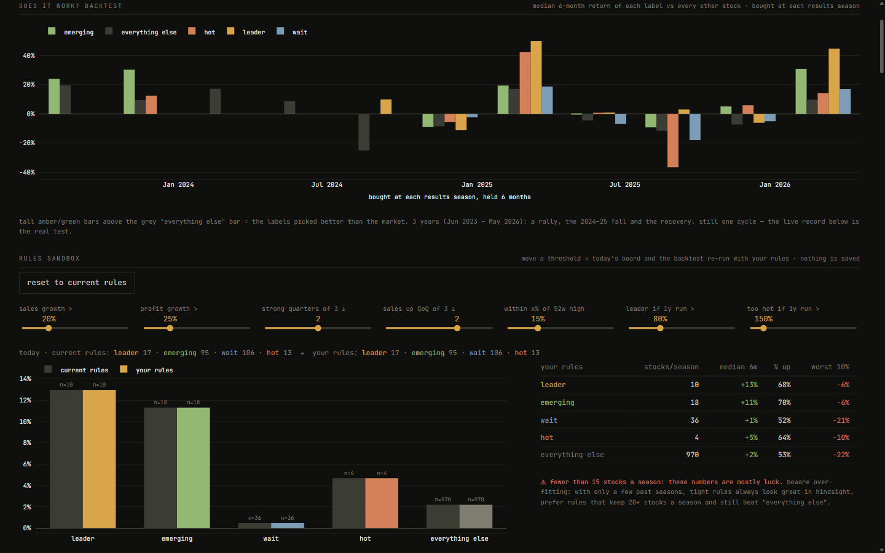
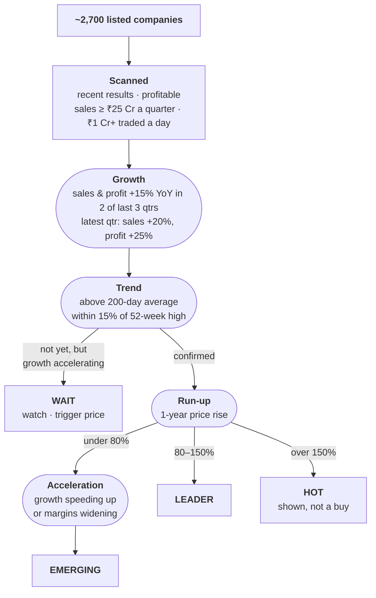
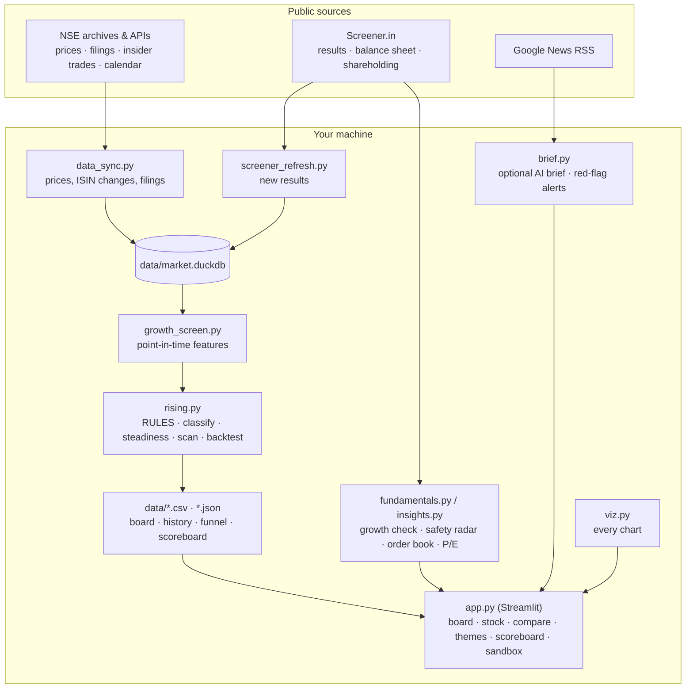

<div align="center">

# Rising Stocks Terminal

**A calm, evidence-first research terminal for Indian (NSE) growth stocks.**
Every evening it scans ~2,700 listed companies, finds the few whose business is genuinely accelerating
*and* whose price confirms it, and shows you — visually and transparently — exactly why each one made the list.

[](https://www.python.org/)
[](https://streamlit.io/)
[](https://duckdb.org/)
[](#data-sources-and-privacy)
[](LICENSE)



</div>

---

## Why this exists

Most retail investors in India buy on a tip — a Telegram channel, a YouTube thumbnail, a friend — and then hold
and hope. The information needed to do better is public (NSE price files, quarterly results, filings, insider
trades), but it is scattered across a dozen sites and buried in tables.

**Rising Stocks Terminal** turns that public data into one daily answer:

> *Which companies are really growing right now — and is the market starting to notice?*

It is built around three principles:

| | |
|---|---|
| **Evidence, not opinion** | Every rule and every threshold is backtested on three years of point-in-time data, and the backtest ships with the app. When a rule didn't hold up, it was dropped. |
| **Transparent, not a black box** | Every stock shows the exact gates it passed, its value against each threshold, what would change its label, and how its score was built. The explanation runs the same code as the scan, and a test keeps them in sync. |
| **Yours, not ours** | Runs entirely on your machine. Market data needs no account or key. No data leaves your computer except the public requests needed to fetch it. |

> [!IMPORTANT]
> **This is a research tool, not investment advice.** It is not a SEBI-registered advisor and makes no buy/sell
> recommendations. Backtests describe the past, not the future. Markets can and do lose money.

---

## Contents

- [What you get](#what-you-get)
- [How it picks stocks](#how-it-picks-stocks)
- [The evidence](#the-evidence)
- [Quick start](#quick-start)
- [Daily workflow](#daily-workflow)
- [Data sources and privacy](#data-sources-and-privacy)
- [Optional AI brief](#optional-ai-brief)
- [Architecture](#architecture)
- [Reproduce the research](#reproduce-the-research)
- [Limitations](#limitations)
- [Contributing](#contributing)

---

## What you get

### The board — the whole market, narrowed to what matters

Every listed company is scanned after market close and labelled by backtested rules. A funnel shows how ~2,700
listed companies narrow to a buy-list of ~100, with the full rule set one click away. Filters for status,
industry, price (for small accounts) and one-off "lumpy" results.

| Label | Meaning |
|---|---|
| **leader** | Growing strongly, price near highs and above its 200-day average, already up 80–150% in a year |
| **emerging** | Growth accelerating and margins widening, price confirmed, up less than 80% in a year |
| **wait** | Growth is there but the price hasn't confirmed — the *trigger* is the price it must close above |
| **hot** | Passes growth and trend, but already up more than 150% in a year — shown, deliberately **not** a buy |
| **broke** | Dropped off the board since the last scan |

### The stock page — one company, fully explained



- **Company snapshot** — what the company actually does, plus five verdicts on a Best → Critical scale:
  *business*, *sector outlook*, *war & oil risk*, *before buying*, and *overall*. Each comes with a one-line,
  measured reason, e.g. *"fell 1.1× the market on its 12 worst days"*. These rule-based verdicts are free and
  always present; if you add an AI key, the AI's own verdicts sit beside them and a **≠** flags any disagreement.
- **Price chart** with range buttons and **insider buys/sells marked on the chart**.

### How it was ranked — no black box



On every stock, the four gates the scan applies — **growth → acceleration → trend → run-up** — appear as connected
cards, each test drawn as a bar against its threshold. Below them:

- **What would change it** — the exact price that breaks the trend, the price that turns an emerging stock into a
  leader (or a leader into *hot*), and the sales and profit the next quarter must beat.
- **Steadiness score waterfall** — how the score that orders the board was built, part by part.
- **Crowd strips** — where this stock sits among every scanned stock on each metric.
- **Label history** — when it carried which label, at what price.
- **Not scanned?** — the entry conditions it failed, with its numbers.

### Growth story — fundamentals as pictures



- **10-point growth check** in plain English: sales every quarter, operating leverage, margins, cash vs profit,
  return on capital, debt, capacity build-up, promoter holding, receivables.
- **Safety radar** — seven trap checks as one shape (NSE surveillance list, cash backing profit, receivables, real
  dilution, insider selling, core profit, liquidity). Every dent is a named risk.
- **Future growth** — a waterfall from today's sales to what plants under construction could add, plus an
  order-book gauge (years of revenue already booked).
- **Priced in?** — P/E through time against its own usual range, plus PEG.
- **Owners** — promoter, FII and fund holding changes each quarter.
- Revenue and profit with year-on-year growth on every bar, margins against their 3-year band, cash flow, debt.

### Compare, themes, scoreboard and the rules sandbox



- **Compare** — two or three stocks on one growth/quality radar, a side-by-side table, and a quarterly sales
  "growth race".
- **Themes** — a treemap of industries by how many rising companies they hold, coloured by 3-month momentum.
  Many rising names in one industry usually means a real tailwind.
- **Scoreboard** — how each label performed in the backtest against every other stock, plus the live track record.
- **Rules sandbox** — a slider for every threshold. Move one and both today's board and the three-year backtest
  re-run instantly: which names join or leave, the median return per label, and warnings when a sample gets too
  small to trust.



### Your positions — with an exit rule that was tested

The **today** tab tracks what you hold against a backtested exit rule: **sell if the price falls 20% below your
buy price; at six months keep only if it is still a leader or emerging**. It also shows what changed on the board
since yesterday, results due this week, and red-flag filings or negative headlines for your holdings — all
without AI. A **thesis tracker** stores why you bought and shows each quarter whether that reason still holds.
On Windows, desktop notifications fire when a stop is hit, a trigger is crossed or a red flag appears.

### Portfolio — your own trading record, measured

A **portfolio** page (top right) keeps a ledger of every buy and sell: import your broker tradebook (Zerodha
xlsx/csv, or any csv with symbol, date, side, qty, price — re-importing never duplicates) or add trades by hand.
Positions and round trips are worked out from the ledger (FIFO), so a stock you sold leaves your positions on its
own. Instead of repeating your broker's P&L screen, it answers the questions a statement doesn't:

- **Did you follow the system?** For every trade, the label the scan would have given on the day you bought
  (same rules, that day's data), and how your system picks did against your own picks.
- **Discipline** — trades that went past the −20% stop and what holding on cost, how long you keep winners versus
  losers, and what each stock did after you sold.
- **Hidden costs** — estimated taxes and DP charges as a share of your profit, and the move a typical trade of
  yours needs just to break even.
- **Risk now** — what you'd lose if every stop hit, positions already past the stop, and your largest holding.

Your ledger stays in `data/` on your machine and is never committed.

---

## How it picks stocks

The scan is a sequence of gates. A company must pass each one, using only results already public and prices up
to that day.



Within each label, stocks are ordered by a **steadiness score** (0–100), four equal parts, each a rank among board
stocks:

| Part | Why it is there |
|---|---|
| **Size** | Small caps fell hardest in the 2024–25 correction |
| **Calm price** | Stocks with smaller daily swings hit the −20% stop far less often |
| **Accumulation** | Delivery % rising (shares bought to keep, not traded intraday) |
| **Margin change** | Widening operating margins vs a year ago |

Every threshold lives in one place (`rising.RULES`). The scan, the backtests, the "how it was ranked" panel and the
rules sandbox all read it, so what you are shown can never drift from what actually decides a label.

---

## The evidence

All numbers below come from a **point-in-time study of 35 monthly entry dates (June 2023 – April 2026)**, covering
a strong rally (the typical stock +15% over six months), the 2024–25 small-cap fall, and the recovery. Each month
uses only results public by then (60-day lag) and prices up to that day. Prices are split-adjusted, and one-day
bad prints are removed.

**Labels — median return over the next six months** (scoreboard backtest, every results season):

| Label | Median 6-month return | Picks that rose |
|---|---:|---:|
| leader | **+12.9%** | 68% |
| emerging | **+11.3%** | 70% |
| hot | +4.7% | 64% (worst 10%: −10% or lower) |
| wait | +0.5% | 52% |
| every other profitable, liquid stock | +2.2% | 53% |

**Ordering — top 15 growers each month, return in excess of the typical stock:**

| Ranking method | Excess return | Picks that rose | Hit the −20% stop | Months it beat the market |
|---|---:|---:|---:|---:|
| **Steadiness score** (current) | **+14.5%** | **73%** | **20%** | **88%** |
| Fastest sales and profit growth (previous) | +9.9% | 65% | 32% | 69% |
| Random 15 growers (average of 50 draws) | +10.9% | 65% | 30% | 71% |

Two findings changed the app:

1. **Ranking by the biggest growth numbers did no better than chance.** Huge jumps are often one-offs or low-base
   effects. Steadiness lifted the edge by about half and cut stop-outs from about a third to a fifth, and it held in both
   the falling and the recovering market.
2. **Leaders that had already run more than 150% were the trap.** With the same growth and trend, they hit the
   −20% stop 61% of the time against 29% for leaders up 80–150%, and returned +8.5% above the typical stock
   against +16.2% — worse in every period. They now carry their own **hot** label instead of counting as leaders.

Ideas that were tested and **dropped** because they did not survive the longer history: excluding growth spikes
above 100%, a hard volatility filter, a market-breadth regime switch, and momentum as a ranking factor (it worked
in rising markets and lost money in the 2024–25 fall).

**Exit rule** (`exit_backtest.py`, 209 completed trades from every results season since mid-2023; every rule
exits by six months at the latest, so they are compared like for like):

| Exit | Mean | Median | Picks up | Worst trade | Worst 10% |
|---|---:|---:|---:|---:|---:|
| Hold six months, no stop | +8.2% | +3.6% | 54% | −50% | −27% |
| **−20% stop, review at six months** (current) | +5.6% | −4.6% | 46% | **−34%** | **−22%** |
| Sell when quarterly growth breaks | +7.1% | +3.6% | 52% | −54% | −26% |
| Growth break or −20% stop | +4.7% | −3.1% | 45% | −34% | −22% |

The stop is insurance, and it has a price: about 2½ points of average return, in exchange for cutting the worst
trade from −50% to −34%. That suits a small account that can't afford one disaster; a larger, diversified portfolio
might prefer to hold. Selling when growth breaks looked better in an earlier test only because that version held for
up to a year; at the same horizon it adds nothing, so it stays a warning on your positions, not an exit.

---

## Quick start

**Requirements:** Python 3.11 or newer (developed on 3.14), about 1 GB of free disk space, and an internet connection.

```bash
git clone https://github.com/webtools-dotcom/growing-stocks.git
```

```bash
cd growing-stocks
```

```bash
pip install -r requirements.txt
```

**Open it like an app (no terminal):** create a desktop shortcut once, then double-click **Rising Stocks**. It
starts quietly and opens in its own window; closing the window stops it.

```bash
python make_shortcut.py
```

Or double-click `launch.pyw`, or run it the developer way:

```bash
streamlit run app.py
```

Then click **update data**. The first run builds a local database from public sources: about 1.5 years of NSE
end-of-day prices and the results of every liquid company (~1,500) — roughly 30 minutes, once. After that a daily
update takes a minute or two.

For the full three-year backtests, fetch more price history (about 30–40 minutes, once):

```bash
python data_sync.py backfill 1650
```

---

## Daily workflow

1. **After 7 pm IST** (when NSE publishes the day's file), click **update data** — or schedule `daily_update.bat`
   in Windows Task Scheduler. The update runs on its own, so you can close or reload the page while it works.
2. Open **today** — positions against the exit rule, what changed on the board, results this week, red flags.
3. Open **board** — new leaders and emerging names, best-ordered first.
4. Open any name on the **stock** page — read the snapshot, check how it was ranked, look at the growth story.
5. Write down **why** you bought in the thesis tracker. The app checks it every quarter.

---

## Data sources and privacy

| Data | Source | Key needed |
|---|---|---|
| Prices, volume, delivery % | NSE daily bhavcopy (public archive) | none |
| Listed companies, ISINs, ISIN changes | NSE equity list | none |
| Quarterly and annual results, balance sheet, cash flow, shareholding | Screener.in company pages | none |
| Announcements, results calendar, insider trades, surveillance lists, industries | NSE public APIs and archives | none |
| News headlines for red-flag alerts | Google News RSS | none |
| AI brief (optional) | your own LLM provider via litellm | yours |

- Everything is stored locally in `data/` (a DuckDB database plus small cache files). **No market data is stored
  in or distributed with this repository.**
- Public sources are read politely: one request at a time, with pauses. Respect each source's terms of use; this
  tool is for personal research.
- The app listens only on `localhost`, so other devices on your network can't open it.
- Data files are written crash-safely (temp file, then swap), so a power cut mid-update can't corrupt them, and
  updates wait their turn for the database instead of failing when two things touch it at once.

---

## Optional AI brief

Market data never needs a key. If you want plain-English explanations, open **settings** (top right), pick a
provider — **Gemini, Anthropic, OpenAI, Groq or OpenRouter** — paste your own key and press **test**.

- The brief reads the company's NSE filings (PDFs), red-flag announcements, recent news and the app's own measured
  facts, then explains the charts, why the company is growing, and what could go wrong — with sources.
- Inputs are digested locally first, so a brief costs about 5,000 tokens (free tiers work), and it is cached until
  something actually changes.
- It explains; it never picks stocks.
- Your key is stored in the operating system's credential store (Windows Credential Manager, macOS Keychain or
  Linux Secret Service) — never in a file, never in the repo, and never shown again after saving. Environment
  variables or a local `.env` (see `.env.example`) also work.

---

## Architecture



| File | Does |
|---|---|
| `app.py` | The Streamlit UI |
| `rising.py` | Rules, labels, the "how it was ranked" explainer, daily update and scan, scoreboard backtest, exit rule, notifications |
| `growth_screen.py` | Loads the database; point-in-time growth, trend, volatility and accumulation features |
| `data_sync.py` | Builds and updates the local database from NSE; split adjustment, ISIN-change merging, history backfill |
| `screener_refresh.py` | Latest quarters, capex and industry for scanned companies |
| `fundamentals.py` | Full financials per stock and the 10-point growth check |
| `insights.py` | Safety radar, capacity bridge, order book, margin band, P/E history, insider trades, rule-based verdicts |
| `brief.py` | Optional AI brief and daily red-flag alerts |
| `portfolio.py` | Trade ledger, tradebook import, FIFO positions and round trips, cost estimates, entry-day labels |
| `viz.py` | Every chart builder and the colour palette |
| `research.py` | The 3-year study behind the labels and the steadiness score |
| `exit_backtest.py` | The exit-rule backtest |
| `test_rules.py` | Self-checks for the rules, the explainer, price adjustment, the freshness banner and update tracking |
| `config.py` / `safeio.py` / `settings.py` | Paths and database access, crash-safe file I/O, AI provider and key storage |
| `launch.pyw` / `make_shortcut.py` / `daily_update.bat` | App window, desktop shortcut, scheduled update |

---

## Reproduce the research

Every number in [The evidence](#the-evidence) can be regenerated on your own machine.

```bash
python research.py
```

```bash
python rising.py backtest
```

```bash
python exit_backtest.py
```

```bash
python test_rules.py
```

`research.py` builds the point-in-time panel (35 monthly entries, about 30 candidate signals, the next six months'
return and worst drawdown for every stock), then compares rule sets and ranking methods across three separate
periods. The rules sandbox in the app re-tests any threshold you like in seconds.

---

## Limitations

Honest caveats, so you can weigh the evidence properly:

- **Survivorship bias.** The study uses today's listings, so companies delisted since 2023 are missing. That
  flatters every result a little.
- **Prices are checked against NSE's official files.** Every stored day is re-verified against NSE's archive, and
  days that look wrong are re-downloaded automatically; holidays with invented prices from an old import were removed.
- **Three years is one market cycle.** The period includes a rally, a fall and a recovery, but not a long bear
  market.
- **Historic market cap is estimated** from today's, scaled by price, so share issuance in between is ignored.
- **Results timing is approximated** with a 60-day lag after quarter end rather than exact filing dates.
- **Long-run consistency** (e.g. growth in 4 of the last 6 quarters) couldn't be tested properly yet: too few
  months have ten quarters of history. It will be revisited as data accumulates.
- Desktop notifications and the one-click launcher are Windows-only; the app itself runs anywhere Python does.

---

## Contributing

Issues and pull requests are welcome. Good contributions:

- New signals — with a point-in-time backtest in `research.py` showing they hold in more than one market phase.
- Better visualisations of existing data.
- Data-source robustness (NSE changes its endpoints from time to time).

Please run `python test_rules.py` before opening a pull request, and never commit anything from `data/` or any key.

---

## License

MIT — see [LICENSE](LICENSE). Not affiliated with NSE, Screener.in or any broker.
