<div align="center">

# Rising Stocks Terminal

**A free app that finds Indian (NSE) companies whose business is growing fast, and shows you exactly why.**

Every evening it checks about 2,700 listed companies, keeps the few whose sales and profits are really
growing *and* whose share price agrees, and explains each one with simple charts.

[](https://www.python.org/)
[](https://streamlit.io/)
[](https://duckdb.org/)
[](#your-data-and-privacy)
[](LICENSE)

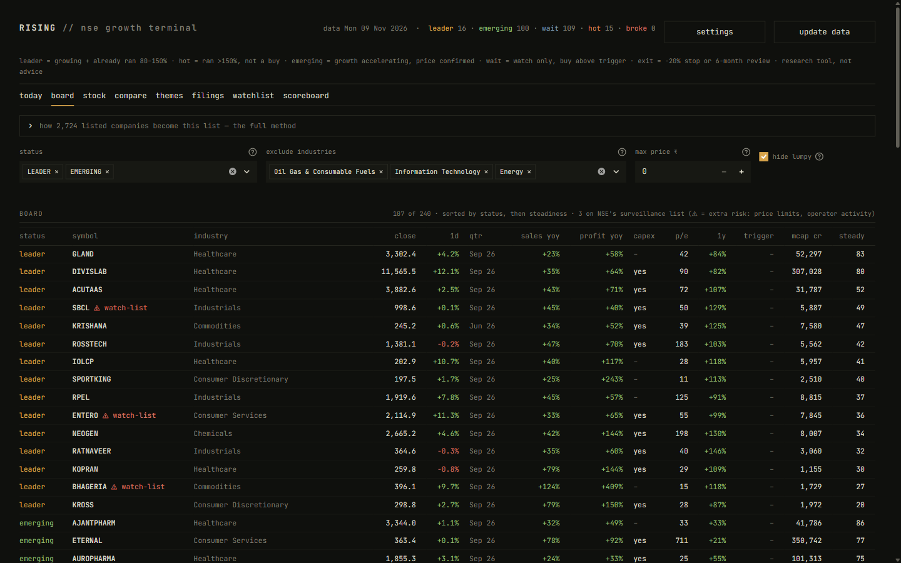

</div>

> [!IMPORTANT]
> **This is a research tool, not investment advice.** It is not a SEBI-registered advisor and it does not tell
> you to buy or sell anything. Every number here describes the past, and the past does not promise the future.
> You can lose money in the stock market.

---

## Contents

1. [What is this, in one minute](#what-is-this-in-one-minute)
2. [Install and first run](#install-and-first-run)
3. [Your daily routine (10 minutes)](#your-daily-routine-10-minutes)
4. [A tour of the app, screen by screen](#a-tour-of-the-app-screen-by-screen)
5. [How a stock gets picked](#how-a-stock-gets-picked)
6. [Does it actually work? The proof](#does-it-actually-work-the-proof)
7. [When to sell: the exit rule](#when-to-sell-the-exit-rule)
8. [Words used in the app](#words-used-in-the-app)
9. [Your data and privacy](#your-data-and-privacy)
10. [Optional extras](#optional-extras)
11. [Common questions and problems](#common-questions-and-problems)
12. [Honest limits](#honest-limits)
13. [For developers](#for-developers)

---

## What is this, in one minute

Most people in India buy shares because of a tip: a Telegram group, a YouTube video, a friend. Then they hold
and hope. The facts you need to do better are all public (daily share prices, quarterly results, company
announcements, what the owners are buying or selling) but they are spread across many websites and hidden in
long tables.

This app collects those public facts every evening and answers one question:

> **Which companies are really growing right now, and is the market starting to notice?**

Three promises it keeps:

| Promise | What it means for you |
|---|---|
| **Proof, not opinion** | Every rule was tested on three years of past data before it was used, and the test comes with the app so you can run it yourself. Rules that failed the test were thrown out. |
| **Nothing hidden** | For every stock you can see which checks it passed, its real numbers next to each limit, and what would change its label. |
| **Runs on your computer** | No account, no subscription, no key needed for market data. Your data stays on your machine. |

---

## Install and first run

You need **Python 3.11 or newer**, about **1 GB of free disk space** and an internet connection.
If you don't have Python, install it from [python.org](https://www.python.org/downloads/) and tick
"Add Python to PATH" during setup.

**Step 1.** Download the app:

```bash
git clone https://github.com/webtools-dotcom/growing-stocks.git
```

(No git? On the GitHub page click **Code → Download ZIP** and unzip it.)

**Step 2.** Go into the folder:

```bash
cd growing-stocks
```

**Step 3.** Install what it needs (one time):

```bash
pip install -r requirements.txt
```

**Step 4.** Make a desktop shortcut (one time, Windows):

```bash
python make_shortcut.py
```

Now double-click **Rising Stocks** on your desktop. The app opens in its own window. Closing the window stops it.
On Mac or Linux, or if you prefer the terminal, run `streamlit run app.py` instead.

**Step 5.** Click **update data** (top right). The first time, the app builds its own database from public
sources: about 1.5 years of daily prices for every NSE stock and the results of every company that trades enough
(about 1,500). **This takes around 30 minutes, once.** You can keep using your computer, close the page, or even
quit: next time it continues from where it stopped. After that, each daily update takes a minute or two.

**Optional, for the full 3-year tests** (about 30–40 minutes, once):

```bash
python data_sync.py backfill 1650
```

---

## Your daily routine (10 minutes)

1. **After 7 pm India time** (when NSE publishes the day's prices), click **update data**. Or let Windows do it
   for you every evening by scheduling `daily_update.bat` in Task Scheduler.
2. Open **today**: your open positions, anything that hit the exit rule, red-flag news, what changed on the list,
   and results coming up.
3. Open **board**: the growing companies, best first.
4. Click any name you like to open its **stock** page. Read the snapshot, check *how it was ranked*, and look at
   the growth charts.
5. If you buy, add the trade in **portfolio** and write down **why** you bought. Each quarter the app checks if
   that reason still holds.

---

## A tour of the app, screen by screen

The top bar shows the date of the data and how many stocks carry each label. The buttons on the right are
**portfolio**, **settings** and **update data**. Below that are the tabs.

### The labels (you'll see these everywhere)

| Label | In simple words | What to do with it |
|---|---|---|
| **leader** | Business growing strongly, price near its highs, already up 80–150% in a year | The strongest group in the tests |
| **emerging** | Growth is speeding up or profit margins are getting wider, and the price has started to agree. Up less than 80% in a year | Earlier stage, similar results in the tests |
| **wait** | Business is growing but the price hasn't agreed yet | Watch only. The **trigger** is the price it has to close above first |
| **hot** | Passes everything, but already up more than 150% in a year | Shown on purpose, **not** a buy: these fell hardest in the tests |
| **broke** | Was on the list yesterday, isn't today | Check why, especially if you own it |

### today: what needs your attention

- **Open positions**: each stock you still hold, your profit or loss, how far it is from the −20% stop, the
  6-month review date, and a clear signal: *hold*, *review* or *exit*.
- **Thesis health**: the growth check on the day you bought next to the same check today, so you can see if the
  reason you bought is still true.
- **News and red flags**: worrying company announcements and negative headlines for what you hold and watch, from
  the last 14 days. No AI is used for this.
- **Changes since the last scan**, **results coming up** this week, and **watchlist names near their trigger**.
- On Windows you get a desktop notification when a stop is hit, a trigger is crossed or a red flag appears.

### board: the whole market, narrowed down

Every company is checked after the market closes and given a label. A funnel shows how about 2,700 companies
shrink to a list of around 100. Within each label, stocks are sorted by a **steadiness score** (explained
[below](#step-2-sort-by-steadiness)), so the calmest, best-supported names come first.

Filters: label, industries to hide, a **max price** box (handy for small accounts: about ₹2,500 suits a ₹10,000
account) and **hide lumpy**, which hides companies whose latest result jumped because of a one-off.

### breakouts: chart patterns, checked against 20 years of history

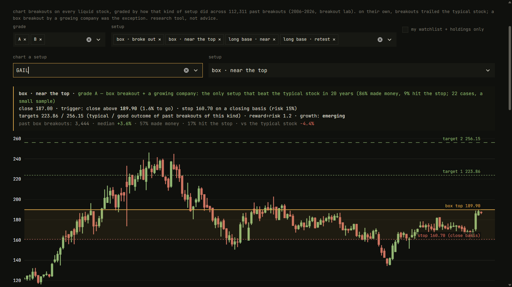

Many traders buy when the price "breaks out" of a pattern on the chart. This tab finds those patterns on every
stock that trades at least ₹1 crore a day, and then tells you something most chart tips never do: **how this
kind of breakout actually worked out in the past.**

The four patterns it looks for:

| Pattern | What it looks like | How it did in 20 years (112,311 past breakouts, 2006–2026) |
|---|---|---|
| **box** | The price moves sideways in a narrow range for 6+ months, then closes above the top of that range | 57% made money, 17% hit the stop. The steadiest pattern |
| **long base** | A price level the stock touched 3+ times over 3+ years and couldn't close above, then finally does | Half did little (middle result +1%), a few went up a lot, so the average was +22%. Like a lottery |
| **trendline** (weekly) | A falling line joining lower and lower peaks, then a close above it | Lost to the average stock in every test |
| **swing line** (daily) | The same idea on a short daily chart, for quick trades | Lost to the average stock in every test |

**The honest result:** on their own, breakouts did *worse* than simply holding an average stock. There was one
exception. **Grade A** is a box breakout by a company this app already marks as *leader* or *emerging*: 86% made
money and only 9% hit the stop. But that is only 22 cases since 2023, so treat it as a hint, not a promise.
It matches the lesson of the whole app: **a growing business plus a price that agrees beats either one alone.**

Every setup gets:
- **Grade A, B or C.** A = box + growing company. B = any box, or a long base touched 4+ times (held up better
  than most, but still trailed the average stock). C = everything else.
- **Trigger**: the closing price that counts as a breakout. **Gap** shows how far away it is ("2% to go") or how
  far above it the price already is ("3% above").
- **Stop**: the closing price where the idea is wrong. It uses the *closing* price on purpose, because brief dips
  during the day trigger too many false exits.
- **Targets 1 and 2**: the typical and the good result of past breakouts of the same kind, not a guess.
- **Reward ÷ risk**: how much you could make compared with how much you could lose.

Pick any stock from **chart a setup** to see the chart with the pattern, trigger, stop and targets drawn on it.
Long bases use a monthly chart and can go back up to 16 years:

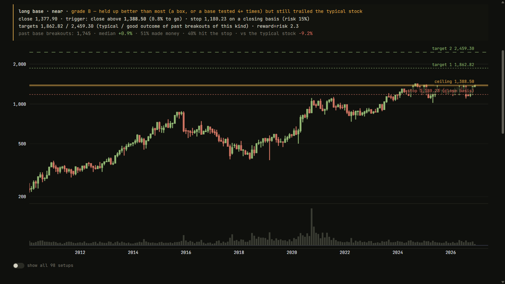

#### Check a tip

Got a tip in a group? Paste the message as it is. The app reads the stock name, the price (CMP), the buy range,
the stop loss (SL) and the targets, then shows:
- how far each one is from today's price,
- whether there is a real chart pattern on that stock right now, and its grade,
- **how often similar setups reached each target before hitting the stop**, from the 20-year history,
- the tip's lines and the app's own lines on one chart.

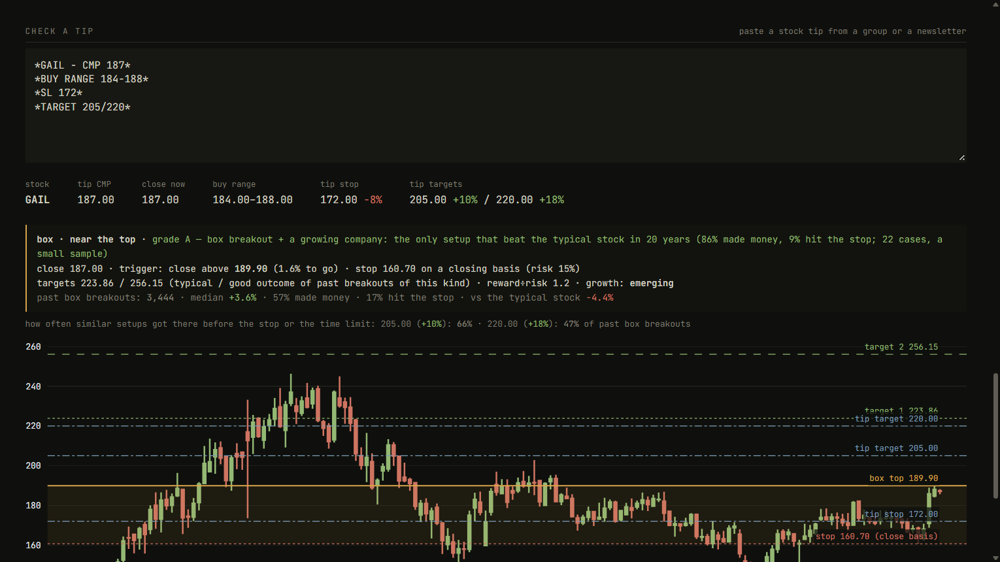

If there is no chart pattern near the price, it says so: the tip may be based on results, news or the sector
instead.

### long-term: for money you'll leave alone for 4–5 years

The rest of Rising looks about six months ahead. This tab is for long-term money, like a small amount put in every
month and left for years. It answers one question honestly: **what, known on the day you buy, came before a stock
doubling over the next 5 years?**

It was tested on 1,078 NSE companies. Each was judged only on what was public on 30 September of 2017, 2018, 2019,
2020 and 2021, then followed for 5 years: 3,819 cases in all. Every result is compared with stocks bought **on the
same day**, because the year you buy matters enormously (28% of stocks doubled from 2017, 74% from 2019).

| What you did | Doubled in 5 years | Lost money |
|---|---:|---:|
| Bought one stock | 47% | 23% |
| **Split the money equally over 5 stocks** | **67%** | **4%** |
| Split it over 5 stocks that were cheap for their sales | 74% | 3% |

What it found, in plain words:

1. **Spreading your money mattered more than picking.** One stock lost money about 1 time in 5; five stocks, about
   1 time in 25.
2. **The price you pay mattered most.** Stocks that were cheap for their sales (price-to-sales) doubled more often
   than the other stocks bought the same day, in every one of the 5 years.
3. **"Good company" checks on their own did not raise the chance of doubling.** Steady sales, a high return on
   capital and low debt were usually already priced in. They did make a 50% fall a little less likely.
4. **Loss-making companies** lost money most often (34%).
5. **Nothing is a sure thing.** The best odds of a single stock doubling were about 6 in 10.

The tab has four views. It opens on the list:

- **list**: like the board, but for long-term money. Every stock is placed in the best tested group it belongs to,
  in order of past odds (± = compared with stocks bought the same day):

  | Group | What it means | Doubled in 5 yrs | Lost money | 5 such stocks: lost money |
  |---|---|---:|---:|---:|
  | 1. cheap + healthy + improving | cheap for its sales, F-score 6+ of 9, profitable, pays its interest, 3+ of 5 improving signs | 53% (+8) | 18% (−6) | 1% |
  | 2. cheap + healthy | the same, with 2 improving signs | 52% (+6) | 18% (−6) | 1% |
  | 3. cheap | cheap for its sales and profitable | 55% (+7) | 19% (−4) | 2% |
  | 4. fair price | P/E under 40, not already up 100%+ in a year | 54% (+3) | 16% (−4) | 2% |
  | 5. strong but pricey | 4+ good-company checks, but not cheap | 47% (−5) | 19% (−1) | 4% |
  | 6. loss-making | made a loss in its latest year | 43% (−1) | 34% (+9) | 10% |

  - **F-score** (Piotroski): 9 yes/no checks that the business got healthier over the last year (profit, cash, return
    on assets, debt, margins, sales per rupee of assets, no new shares). Indian studies report it separating winning
    cheap stocks from value traps.
  - **Improving signs** (5): growth speeding up, profit up 15%+, price above its 200-day average, a strong 12-month
    trend, and a P/E below its own usual level.
  - **Warnings**, shown beside each stock and hidden by default: weak F-score, can barely pay interest, falling knife,
    price crashed 50%+ in a year, already up 150%+ in a year, many new shares, tiny or penny, loss-making. In the
    test, each raised the chance of losing money. Two more are live only (there's no history to test them on):
    NSE's ASM/GSM watch lists, and serious filings (insolvency, forensic audit, SEBI orders, an auditor resigning).

  How this was tested: the rules were chosen on buy years 2017–2020 only, then checked once on hidden years 2021 and
  2022. "Cheap + healthy + improving" beat stocks bought the same day in every training year and in both hidden years,
  mostly by losing less: fewer losses and fewer 50% crashes. In a simulation of ₹1,000 a month from Oct 2017 to Sep 2022,
  spread over 5 stocks a month, every tested group beat random picks (₹60,000 became about ₹2.4 lakh vs ₹2.05 lakh),
  though plain "cheap" ended slightly ahead in that rally. It's a list of groups with better past odds, not a buy list.
- **what the test found**: the chart and tables above, with every check's result.
- **check a stock**: six yes/no questions anyone can read (Is it selling more every year? Is the profit real cash?)
  with the actual numbers, whether it made a profit in its latest year, where its price sits among today's stocks
  (cheap, middle or expensive), and how past stocks in the same group did.
- **my long-term stocks**: your open positions through the same lens, and how spread out your money is.

Be careful with these numbers: only companies still listed today are in the data (ones that went bust are missing,
which flatters the "cheap" result), and 2017–2026 was a period that favoured cheap and smaller companies.

**Setup (once):** the scores need each company's yearly results from Screener.in. Run this once (about an hour; if it
stops, run it again and it continues). After that, every **update data** keeps the scores current.

```bash
python longterm.py fetch
```

### stock: one company, fully explained

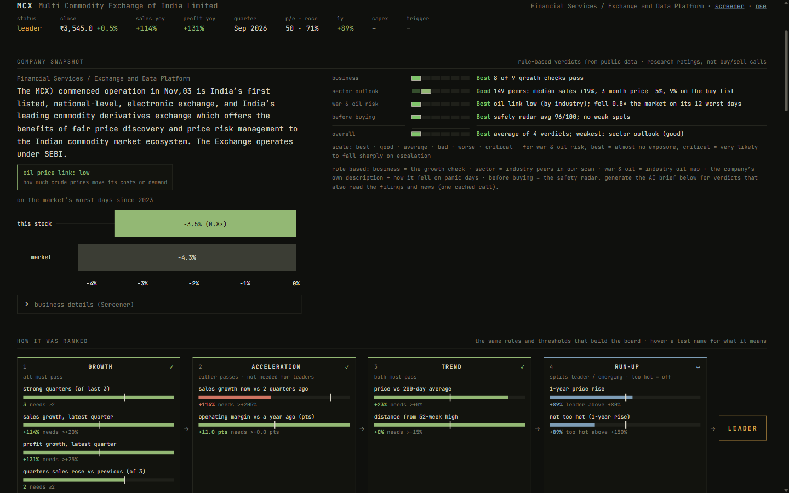

- **Company snapshot**: what the company actually does, in plain words, and five meters from *Best* to
  *Critical*: business, sector outlook, war and oil risk, things to check before buying, and overall. Each one
  has a short measured reason, for example *"fell 1.1× as much as the market on its 12 worst days"*. These come
  from rules and are always free. If you add an AI key, the AI's view appears next to them and a **≠** marks any
  disagreement.
- **Price chart** with range buttons, and **insider buys and sells marked on the chart** (when owners or
  directors bought or sold shares).

#### How it was ranked: no black box

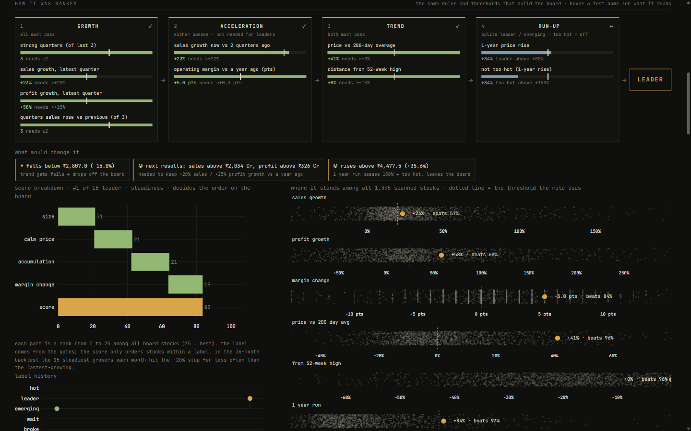

The four checks (**growth → speeding up → price trend → how far it already ran**) appear as connected cards.
Each test is drawn as a bar against its limit, so you can see at a glance if it passed easily or only just.
Below them:

- **What would change it**: the exact price that would break the trend, the price that would move it up or down a
  label, and the sales and profit the next quarter must beat.
- **Steadiness score**: how its score was built, piece by piece.
- **Crowd strips**: where this stock sits among all checked stocks on each measure.
- **Label history**: when it carried which label, and at what price.
- **Not on the list?** If a stock wasn't checked at all, it shows which entry condition it failed, with its numbers.

#### The growth story, in pictures

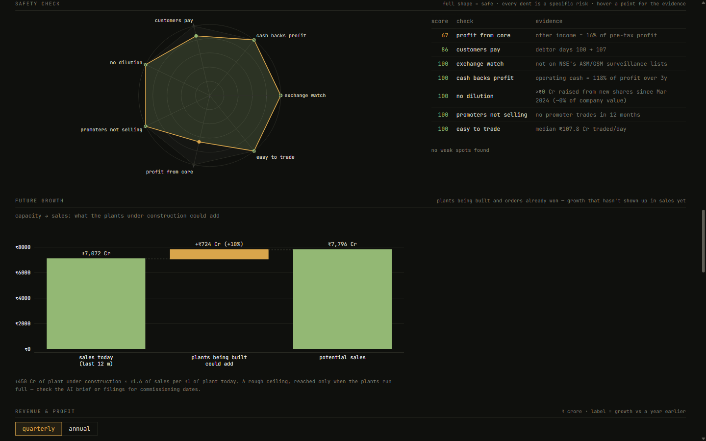

- **10-point growth check** in plain English: are sales growing every quarter, is profit growing faster than
  sales, are margins healthy, is real cash coming in (not just paper profit), return on capital, debt, new
  factories being built, promoter holding, and money owed by customers.
- **Safety radar**: seven common traps drawn as one shape. Every dent is a named risk: the NSE watch list, profit
  not backed by cash, customers paying late, new shares diluting you, insiders selling, one-off profits, and
  shares that are hard to sell.
- **Future growth**: a chart from today's sales to what new factories under construction could add, and the
  **order book** (how many years of work the company has already won).
- **Priced in?** The P/E today against its own usual range over the years, plus PEG.
- **Owners**: how promoter, foreign investor and mutual fund holdings changed each quarter.
- Sales and profit with growth printed on every bar, margins against their 3-year range, cash flow and debt.
- **AI brief** (optional): a plain-English explanation of these charts. See [Optional extras](#optional-extras).

### compare, themes, filings, watchlist and scoreboard

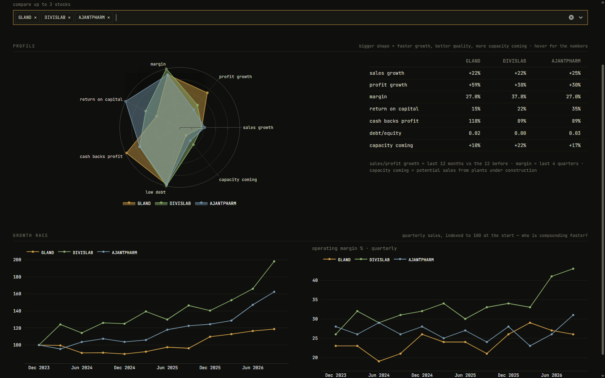

- **compare**: two or three stocks on one growth and quality chart, a side-by-side table, and a race of their
  quarterly sales.
- **themes**: a map of industries sized by how many growing companies they have, coloured by how their prices
  moved in the last 3 months. Many growing companies in one industry usually means real demand behind it.
- **filings**: important company announcements from the last few days (new capacity, big orders, results,
  investor presentations), for names on the board only or for every company.
- **watchlist**: type the symbols you want to follow. It shows each one's label, price, trigger, how far it has to
  go, and flags like *triggered*, *dropped off* or *ran too far*.
- **scoreboard**: how each label did in the past compared with every other stock, and the live track record.

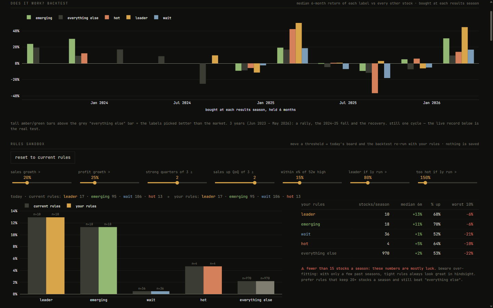

The **rules sandbox** on the scoreboard has a slider for every limit. Move one, and both today's list and the
3-year test re-run straight away: which stocks join or leave, how each label would have done, and a warning when
too few stocks are left to trust the result. Nothing is saved, so play freely.

### portfolio: your own trading record, measured

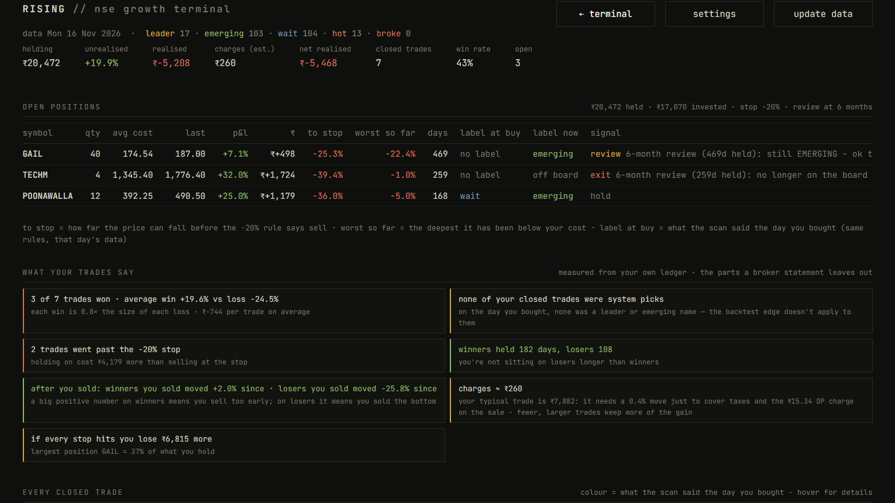

*(The screenshot uses made-up example trades.)*

Click **portfolio** (top right). Add buys and sells by hand, or import your broker's **tradebook** (Zerodha
xlsx/csv, or any csv with symbol, date, side, quantity and price). Importing the same file twice never creates
duplicates. Your positions are worked out from this list of trades, so a stock you sold disappears from your
positions by itself. Bonus shares and splits are applied automatically from NSE's records, so a 3:2 bonus does
not show up as a fake 60% loss.

Instead of copying your broker's profit-and-loss screen, it answers the questions a broker statement doesn't:

- **Did you follow the system?** For each trade, the label the app would have given the stock *on the day you
  bought it* (same rules, that day's data), and how those picks did compared with your own picks.
- **Discipline**: trades that fell past the −20% stop, and how much holding on cost you. How long you keep
  winners compared with losers. What each stock did *after* you sold it (big gains after selling winners means
  you sell too early).
- **Hidden costs**: estimated taxes and charges as a share of your profit, and how much a typical trade of yours
  must rise just to cover them. Small trades lose a lot to fixed charges.
- **Risk right now**: how much you would lose if every stop were hit, and how big your largest position is.

Want a stock kept out of the portfolio (for example shares you got in an IPO quota)? Add it to the
"keep out of the portfolio" box. Your trades stay in the `data/` folder on your computer and are never uploaded.

### settings

Choose an AI provider and paste your own key (optional, see below). Market data never needs a key.

---

## How a stock gets picked

### Step 1: four checks

A company has to pass each check in order. It only uses results that were already public and prices up to
that day, so there's no peeking into the future.

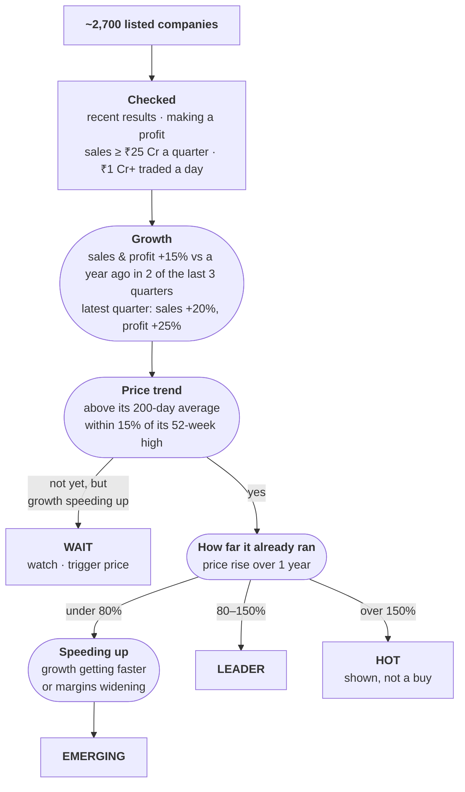

### Step 2: sort by steadiness

Inside each label, stocks are sorted by a **steadiness score** from 0 to 100. It has four equal parts, and each
part compares the stock with the others on the list:

| Part | Why it matters |
|---|---|
| **Size** | Small companies fell the hardest in the 2024–25 fall |
| **Calm price** | Stocks with smaller daily swings hit the −20% stop much less often |
| **Buying to keep** | Delivery % going up: more shares bought to hold, not just traded within the day |
| **Margins widening** | The company keeps more profit from each rupee of sales than a year ago |

All the limits live in one place in the code (`rising.RULES`). The scan, the tests, the "how it was ranked" panel
and the sandbox all read from it, so what you see can never be different from what actually decides a label.

---

## Does it actually work? The proof

The rules were tested like this: go back to the start of each month from **June 2023 to April 2026** (35 months),
use only the results and prices public on that date, pick the stocks, and see what happened over the next six
months. That period had a strong rise (the average stock +15% in six months), the 2024–25 small-cap fall, and
the recovery. Prices are adjusted for splits and bonuses, and one-day bad prices are removed.

**How each label did over the next six months** (bought at every results season):

| Label | Middle result | How many went up |
|---|---:|---:|
| leader | **+12.9%** | 68% |
| emerging | **+11.3%** | 70% |
| hot | +4.7% | 64% (the worst 10% lost 10% or more) |
| wait | +0.5% | 52% |
| every other profitable, liquid stock | +2.2% | 53% |

*"Middle result" (the median) means half did better and half did worse. It isn't pulled up by one lucky stock.*

**Does the sorting help? The top 15 growing companies each month, compared with the average stock:**

| How the 15 were chosen | Extra return | How many went up | Hit the −20% stop | Months it beat the market |
|---|---:|---:|---:|---:|
| **Steadiness score** (used now) | **+14.5%** | **73%** | **20%** | **88%** |
| Fastest growth numbers (used before) | +9.9% | 65% | 32% | 69% |
| 15 random growing companies (average of 50 tries) | +10.9% | 65% | 30% | 71% |

Two surprises that changed the app:

1. **Picking the biggest growth numbers did no better than picking at random.** Huge jumps are often one-offs, or
   growth from a very small starting point. Sorting by steadiness improved the extra return by about half and cut
   the number of stopped-out trades from about one in three to one in five. It worked in both the falling and the
   rising market.
2. **Leaders that had already risen more than 150% were a trap.** With the same growth and trend, they hit the
   −20% stop 61% of the time, compared with 29% for leaders up 80–150%. They now get their own **hot** label.

Ideas that were tested and **thrown out** because they didn't hold up: removing growth jumps above 100%, a strict
"calm price only" filter, switching rules depending on the overall market, and sorting by recent price momentum
(it worked in rising markets and lost money in the 2024–25 fall).

You can re-run every number yourself. See [For developers](#for-developers).

---

## When to sell: the exit rule

The app suggests one simple rule for what you hold:

> **Sell if the price closes 20% below what you paid. At six months, keep it only if it is still a leader or
> emerging.**

Is that the best rule? Here is the honest test (209 finished trades, every results season since mid-2023; every
rule sells within six months, so they are compared fairly):

| Exit rule | Average | Middle result | How many went up | Worst trade | Worst 10% |
|---|---:|---:|---:|---:|---:|
| Hold six months, no stop | +8.2% | +3.6% | 54% | −50% | −27% |
| **−20% stop, review at six months** (used now) | +5.6% | −4.6% | 46% | **−34%** | **−22%** |
| Sell when quarterly growth breaks | +7.1% | +3.6% | 52% | −54% | −26% |
| Growth break or −20% stop | +4.7% | −3.1% | 45% | −34% | −22% |

**What this means:** the stop is like insurance, and insurance costs something. It gives up about 2½ points of
average return, and in exchange your worst trade is −34% instead of −50%. For a small account that can't afford
one big disaster, that's usually worth it. A bigger, well-spread portfolio might prefer to just hold. Selling
when growth breaks is shown as a **warning** on your positions, not an exit, because it didn't help at the same
six-month horizon.

---

## Words used in the app

| Word | Meaning |
|---|---|
| **CMP** | Current market price |
| **YoY** | Compared with the same quarter a year ago |
| **QoQ** | Compared with the previous quarter |
| **200-day average** | The average closing price over the last 200 trading days. Above it usually means the trend is up |
| **52-week high** | The highest price in the last year |
| **Trigger** | The closing price a stock must go above before the setup counts |
| **Stop / SL** | The price where you accept you were wrong and sell, to keep the loss small |
| **Margin** | How much of each ₹100 of sales the company keeps as profit |
| **Delivery %** | The share of traded shares that buyers actually took home, rather than buying and selling the same day |
| **P/E** | Share price divided by yearly profit per share. Higher means the market is paying more for each rupee of profit |
| **PEG** | P/E divided by the growth rate. Around 1 or below is often seen as reasonable for a fast grower |
| **Order book** | Work the company has already won but not yet delivered |
| **Promoter** | The founders or main owners of the company |
| **Insider trade** | When promoters, directors or senior staff buy or sell their own company's shares |
| **Split / bonus** | The company gives you more shares. The price drops to match, so your total value stays the same |
| **Median ("middle result")** | Half the results were better and half worse |
| **Backtest** | Testing a rule on past data to see how it would have done |
| **Breakout** | The price closing above a level it couldn't get past before |
| **Lumpy** | A result boosted by a one-off, like selling land, rather than normal business |

---

## Your data and privacy

| Data | Where it comes from | Key needed? |
|---|---|---|
| Prices, volume, delivery % | NSE daily price files (public) | No |
| List of companies, ISIN changes | NSE equity list | No |
| Quarterly and yearly results, balance sheet, cash flow, shareholding | Screener.in company pages | No |
| Announcements, results calendar, insider trades, watch lists, industries | NSE public pages | No |
| News headlines for red flags | Google News RSS | No |
| Older prices for long chart bases (optional) | Upstox historical data | Your free Upstox token |
| AI brief (optional) | The AI provider you choose | Your own key |

- **Everything is saved on your computer** in the `data/` folder. No market data is stored in this repository or
  sent anywhere.
- Public websites are read politely: one request at a time, with pauses. Please respect each site's terms; this
  is for personal research.
- The app only opens on your own computer (`localhost`). Other devices on your Wi-Fi can't see it.
- Files are saved safely (written to a temporary file first, then swapped in), so a power cut in the middle of an
  update can't corrupt them.

---

## Optional extras

### AI brief

Market data never needs a key. If you'd like plain-English explanations, open **settings**, pick a provider
(**Gemini, Anthropic, OpenAI, Groq or OpenRouter**), paste your own key and press **test**.

- The brief reads the company's NSE filings, red-flag announcements, recent news and the app's own numbers, then
  explains the charts, why the company is growing, and what could go wrong, with sources.
- It's cheap: about 5,000 tokens per brief (free tiers work), and it's saved until something changes.
- **It explains; it never picks stocks.**
- Your key is stored in your computer's password store (Windows Credential Manager, macOS Keychain or Linux
  Secret Service). It is never written to a file, never put in the repository, and never shown again after you
  save it. A `.env` file also works (see `.env.example`).

### Longer price history for long bases

The app's own price history starts in 2022, so without extra data a "long base" can be at most about 4.5 years
long. If you have an Upstox account, you can add daily prices back to 2006, and bases of up to 16 years will show
up.

1. Create a free **analytics token** in your Upstox developer account.
2. Put it in a file called `.env` in the app folder: `UPSTOX_ACCESS_TOKEN=your-token`
3. Run this once (about 1.5 hours; if it stops, run it again and it continues):

```bash
python long_history.py
```

The old prices are matched to the app's own prices over the weeks where both exist. If the two sources disagree
for a stock, that stock simply keeps the app's own prices, so bad data can't sneak in.

---

## Common questions and problems

**The update says there's no new data.**
NSE publishes the day's prices in the evening, usually after 7 pm India time. On holidays and weekends there's
nothing new.

**My computer crashed (or I closed the app) during an update.**
Nothing is lost. Click **update data** again and it continues from where it stopped.

**The first update is slow.**
It's downloading years of data one request at a time, to be polite to the websites. It's a one-time wait.

**A stock I know is missing from the board.**
Open it on the **stock** page. If it wasn't checked, the page shows which entry condition it failed (for example
too little trading, or a loss last quarter). If it was checked, *how it was ranked* shows which check it failed.

**A stock fell 50% overnight on my chart.**
That's usually a split or bonus. The app adjusts for these automatically. If you still see one, run the update
again; it re-checks prices against NSE's official files and fixes bad days.

**Do I need to pay for anything?**
No. The AI brief is optional and uses your own key.

---

## Honest limits

So you can judge the evidence fairly:

- **Only today's companies are tested.** Companies that were delisted since 2023 aren't in the tests, which makes
  every result look a little better than it really was.
- **Three years is one market cycle.** It includes a rise, a fall and a recovery, but not a long bear market.
- **Old market values are estimated** from today's, scaled by price. New shares issued in between are ignored.
- **Result dates are estimated** as 60 days after the quarter ends, not the exact filing date.
- **Small samples.** Some results (like grade A breakouts, 22 cases) rest on few examples. The app says so where it
  matters.
- Desktop notifications and the shortcut are Windows-only. The app itself runs anywhere Python does.

---

## For developers

### How it fits together

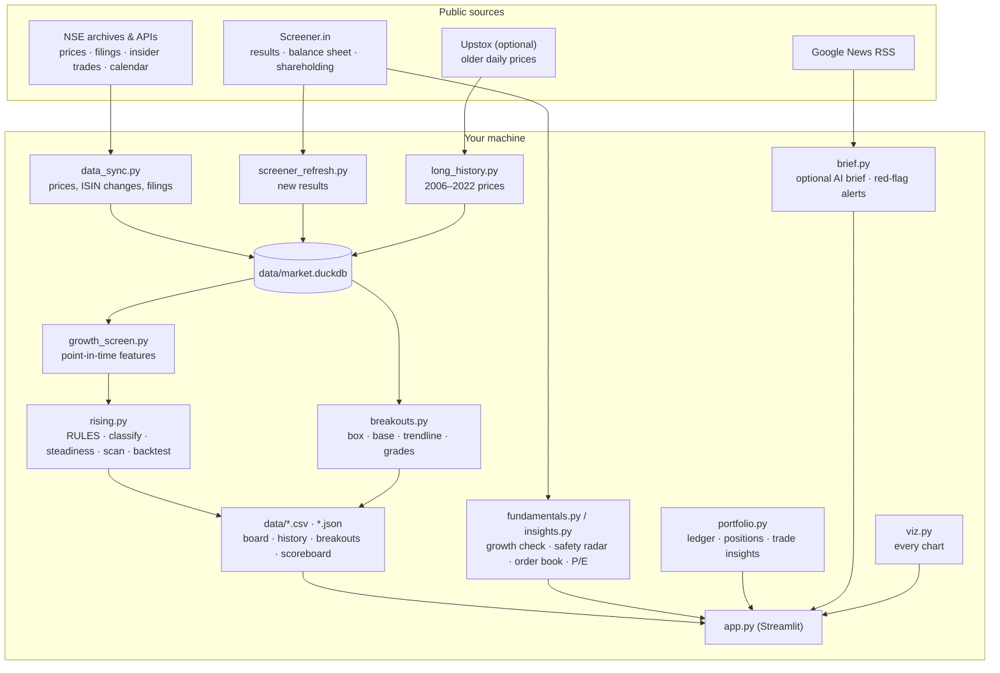

| File | What it does |
|---|---|
| `app.py` | The Streamlit screens |
| `rising.py` | Rules, labels, the "how it was ranked" explainer, daily update and scan, scoreboard backtest, exit rule, notifications |
| `growth_screen.py` | Loads the database; point-in-time growth, trend, volatility and accumulation measures |
| `data_sync.py` | Builds and updates the database from NSE; split adjustment, ISIN-change merging, price checks against NSE, history backfill |
| `screener_refresh.py` | Latest quarters, capex and industry for checked companies (saves every 25 companies, so it can resume) |
| `fundamentals.py` | Full financials per stock and the 10-point growth check |
| `insights.py` | Safety radar, capacity chart, order book, margin range, P/E history, insider trades, rule-based verdicts |
| `brief.py` | Optional AI brief and daily red-flag alerts |
| `portfolio.py` | Trade ledger, tradebook import, bonuses and splits, positions and round trips (FIFO), cost estimates, entry-day labels |
| `breakouts.py` | Box, long base, trendline and swing-line detectors, live scan, grades and plans; results in `breakout_evidence.json` |
| `long_history.py` | Optional one-time download of 2006–2022 daily prices from Upstox, joined onto the app's own prices |
| `longterm.py` | The long-term lens: the long-term lab's checks and groups applied to today's stocks; results in `longterm_evidence.json` |
| `tips.py` | Reads a pasted stock tip (symbol, CMP, buy range, stop, targets) |
| `viz.py` | Every chart and the colour palette |
| `research.py` | The 3-year study behind the labels and the steadiness score |
| `exit_backtest.py` | The exit-rule test |
| `test_rules.py` | Self-checks for the rules, the explainer, price adjustment, the freshness banner, update tracking and the long-history join |
| `config.py` / `safeio.py` / `settings.py` | Paths and database access, crash-safe file writing, AI provider and key storage |
| `launch.pyw` / `make_shortcut.py` / `daily_update.bat` | App window, desktop shortcut, scheduled update |

### Re-run the research

Every number in this README can be regenerated on your own machine:

```bash
python research.py
```

```bash
python rising.py backtest
```

```bash
python exit_backtest.py
```

```bash
python test_rules.py
```

`research.py` builds the month-by-month data (35 entry dates, about 30 possible signals, the next six months'
return and worst fall for every stock), then compares rule sets and sorting methods across three separate
periods. The breakout grades come from a separate 20-year study of 112,311 breakouts; its results are saved in
`breakout_evidence.json`.

### Contributing

Issues and pull requests are welcome. Good contributions:

- New signals, with a point-in-time test in `research.py` showing they work in more than one kind of market.
- Clearer charts for data the app already has.
- Making the data downloads sturdier (NSE changes its pages from time to time).

Please run `python test_rules.py` before opening a pull request, and never commit anything from `data/` or any key.

---

## License

MIT, see [LICENSE](LICENSE). Not connected to NSE, Screener.in, Upstox or any broker.
